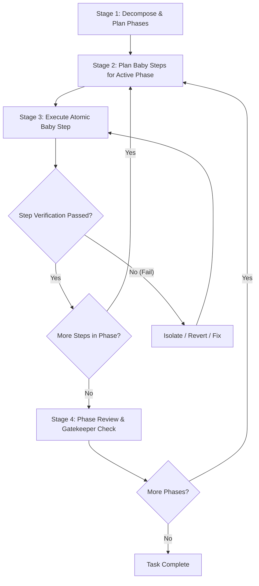

# Baby Steps: Phased Incremental Execution

The **Baby Steps** skill provides a structured, disciplined methodology to break down complex, multi-faceted, or risk-sensitive development tasks into verifiable, bite-sized increments. By preventing large speculative leaps, it guarantees system stability, easy debugging, and constant alignment with the user.

---

## 1. Core Principles (The Baby-Steps Mindset)

1. **One Atomic Change at a Time**: Never modify multiple decoupled subsystems or write hundreds of unverified lines in a single turn. Implement the smallest viable unit of progress.
2. **Immediate Verification**: Every step must be verified before proceeding to the next. Never assume code works because it looks correct.
3. **Zero Cascading Assumptions**: If Step A is uncertain or fails, pause and resolve it. Never build Step B on top of an unverified Step A.
4. **Fast Rollback / Low Blast Radius**: Keep changes so small that rolling back or isolating an issue takes seconds, not hours.
5. **Continuous User Visibility**: Explicitly announce the active phase, the current baby step, and verification results.

---

## 2. The 4-Stage Lifecycle



---

### Stage 1: Decompose into Phases (The Roadmap)

Before writing any code or executing irreversible actions:
1. **Analyze Requirements**: Understand the target objective, constraints, and dependencies.
2. **Divide into Finite Phases**: Group work into logical, sequential phases (typically 3 to 6 phases).
   - *Example Phases*:
     - Phase 1: Discovery, Baseline & Environment Verification
     - Phase 2: Scaffold / Data Models / Interface Signatures
     - Phase 3: Core Implementation (Minimal Working Slice)
     - Phase 4: Edge Cases, Integration & Error Handling
     - Phase 5: End-to-End Verification & Cleanup
3. **Define Definition of Done (DoD)** for each phase.
4. Reference the [Phase Plan Template](./references/phase_template.md) for structuring complex phase plans.

---

### Stage 2: Formulate Baby Steps for the Active Phase

Focus *only* on the current phase. Break it down into granular, sequentially ordered baby steps.
- Each baby step must:
  - Affect ideally 1 file (or 1 tightly coupled pair, e.g., code + test).
  - Take no more than a few focused operations to complete.
  - Have a clear, executable verification test (e.g., compile, run test, inspect file, curl endpoint).

---

### Stage 3: The Baby-Step Execution Loop

For each baby step, strictly follow the **D-E-V-C** cycle:

1. **Declare**: Announce the step with a clear header:
   ```markdown
   ### [Phase X: <Phase Name>] Step X.Y: <Atomic Action Description>
   ```
2. **Execute**: Perform the minimum viable code edit or file change.
3. **Verify**: Run the corresponding validation command immediately:
   - Run unit test or test runner
   - Check build / compilation / linter
   - Inspect output, log, or diff
   - Reference the [Verification Checklist](./references/verification_checklist.md).
4. **Checkpoint**: State the result:
   - ✅ **Passed**: Briefly summarize what passed and advance to Step X.Y+1.
   - ❌ **Failed**: Stop immediately. Do NOT move to the next step. Follow [Recovery Guidelines](./references/recovery_guidelines.md) to fix or revert.

---

### Stage 4: Phase Review & Gatekeeper Check

Once all baby steps in a phase are complete:
1. **Run Full Phase Validation**: Run regression test suite or build verification across all changes in this phase.
2. **Check Git Status / Diff**: Ensure no stray files, unintended modifications, or leftover debug code remain.
3. **Phase Checkpoint Report**:
   - Summarize what was accomplished in this phase.
   - Confirm that all criteria in the Phase's Definition of Done are met.
   - Present the next phase to the user before diving in, allowing for course corrections.

---

## 3. Communication & Status Formatting

Keep the user oriented at all times using standardized status markers:

- `🚀 [Phase X/N: <Name>] Started`: Beginning a phase.
- `⏳ [Phase X/N | Step X.Y] <Action>`: Underway on a specific baby step.
- `✅ [Phase X/N | Step X.Y] Verified`: Step completed and verified with evidence.
- `⚠️ [Phase X/N | Step X.Y] Discrepancy / Failure`: Issue encountered, detailing immediate fix.
- `🎯 [Phase X/N Complete]`: Phase finished and verified; ready for Phase X+1.

---

## 4. When to Use This Skill

Activate this skill when:
- The user asks to:
  - "Take baby steps"
  - "Do this phase by phase / step by step"
  - "Break this down carefully"
  - "Work incrementally and verify as we go"
- Tackling high-complexity tasks:
  - Refactoring legacy codebases
  - Migrating frameworks or upgrading major dependencies
  - Building multi-layered features (backend + schema + frontend + API)
  - Debugging elusive or cascading bugs

---

## 5. References & Resources

- [Phase Plan Template](./references/phase_template.md): Reusable layout for creating phased plans and progress trackers.
- [Verification Checklist](./references/verification_checklist.md): Practical checklist for validating code at each step.
- [Recovery Guidelines](./references/recovery_guidelines.md): Steps to take when a baby step fails or reveals unexpected roadblocks.
